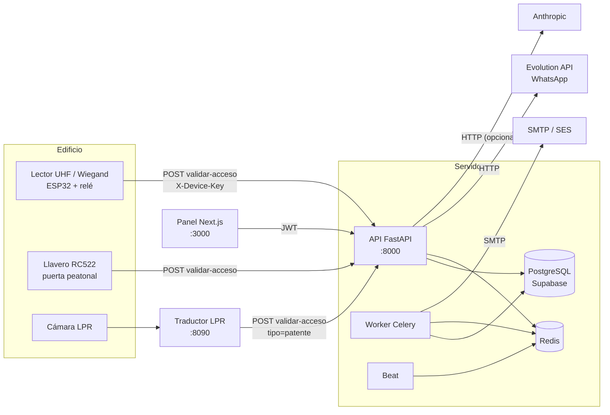

# Sistema de Automatización para Edificios

Plataforma multi-tenant para administrar edificios residenciales: control de accesos vehicular y
peatonal (stickers UHF, llaveros RC522, patentes por cámara, QR de visitas), gastos comunes y
cobranza, reservas de espacios comunes, y avisos a residentes por WhatsApp y correo.

Está compuesta por cuatro piezas que se pueden desplegar por separado:

| Pieza | Carpeta | Tecnología |
|---|---|---|
| API y lógica de negocio | `backend/` | FastAPI, SQLAlchemy 2, Alembic, Celery + Redis |
| Panel de administración | `frontend/` | Next.js 14 (App Router), React 18 |
| Lector del portón | `firmware/esp32/` | MicroPython en ESP32, Ethernet W5500 |
| Traductor de cámaras | `backend/integraciones/lpr/` | FastAPI, adaptadores por marca |

> **Estado.** La lógica de negocio está cubierta por pruebas automáticas. Lo que toca hardware,
> WhatsApp real, correo real y Supabase real **no se ha verificado en producción**: ver la
> [matriz de estado](#estado-de-verificación) antes de depender de cualquiera de ellas.

---

## Tabla de contenidos

- [Arquitectura](#arquitectura)
- [Estado de verificación](#estado-de-verificación)
- [Inicio rápido](#inicio-rápido)
- [Configuración](#configuración)
- [API](#api)
- [Modelo de seguridad](#modelo-de-seguridad)
- [Pruebas](#pruebas)
- [Estructura del repositorio](#estructura-del-repositorio)
- [Decisiones de diseño](#decisiones-de-diseño)
- [Limitaciones conocidas y hoja de ruta](#limitaciones-conocidas-y-hoja-de-ruta)
- [Documentación](#documentación)

---

## Arquitectura



Decisiones de fondo:

- **Multi-tenant por columna.** Toda tabla de negocio lleva `edificio_id`. El token JWT y la
  `X-Device-Key` de cada lector fijan el tenant; ninguna ruta confía en el identificador del cuerpo.
- **El portón es fail-closed.** El relé sólo se activa con respuesta `200` explícita. Red caída,
  timeout, `5xx` o respuesta inesperada: no abre.
- **La decisión de acceso vive en el backend.** Los lectores y el traductor son "sensores": envían
  la credencial y ejecutan la respuesta. Así cambiar una regla no requiere reflashear equipos.
- **Un solo formato canónico por tipo de credencial** (EPC hexadecimal, Wiegand `W26:fac:card`,
  UID RC522, patente normalizada). La unicidad y la búsqueda son exactas.
- **Los secretos nunca van al repositorio.** Todo se configura en `.env`; un escáner y un hook de
  pre-commit bloquean secretos en el código versionado.

---

## Estado de verificación

Cada componente se marca con una de tres categorías. No se deben confundir:

- **Probado con ejecución real:** corrido en esta base de código con los servicios reales locales.
- **Probado con simulador o doble:** la lógica se ejecutó, pero el servicio externo es simulado.
- **Sin probar:** escrito y revisado, pero nunca ejecutado contra el equipo o servicio real.

| Componente | Estado | Cómo se verificó |
|---|---|---|
| Lógica de acceso (modos, correlación sticker↔patente, antirrebote, anti-passback) | Probado con ejecución real | Suite de backend contra SQLite |
| Migraciones Alembic (0001, 0002) | Probado con ejecución real | `upgrade`, `downgrade`, `check` sin diferencias |
| Carga de datos (`seed.py`, `importar_csv.py`, `importar_stickers.py`) | Probado con ejecución real | Tests y CLI sobre base migrada |
| Panel web (administración, portón, ficha, ajustes, prueba de alcance) | Probado con ejecución real | Playwright en modo demo, Chrome real (14/14) |
| Panel contra el backend real | Probado con ejecución real | Playwright contra API + panel con datos sembrados (`scripts/e2e_real.sh`, 3/3) |
| PostgreSQL 16 real | Probado con ejecución real | Migraciones (`upgrade` + `check`) y suite completa contra PostgreSQL; carreras de concurrencia reproducidas sin bloqueo y corregidas |
| Celery + Redis reales | Probado con ejecución real | Worker en proceso `solo` ejecutó `purgar_datos`, `liberar_no_show` y `enviar_email` por la cola |
| Bloqueo de login, rotación de clave de lector, retención y anonimización | Probado con ejecución real | Suite de backend |
| Firmware ESP32 (Wiegand, RS485, RC522, relé, red) | Probado con simulador / Sin probar en equipo | Codificador Wiegand y cruce con el backend; hardware no |
| Traductor LPR | Probado con simulador / doble | Tests contra el backend en memoria |
| Cámaras LPR Hikvision y Dahua | Sin probar | Esqueleto; responde 501 hasta confirmar el formato |
| WhatsApp (Evolution API) | Probado con doble | Sin instancia real |
| Correo (SMTP / SES) | Probado con doble | Sin envío real |
| Supabase (PostgreSQL) | Sin probar | El motor es PostgreSQL y está probado; falta la conexión a **su** proyecto de Supabase |
| Docker Compose | Sin probar | `docker compose config` valida el YAML y los perfiles; este entorno no tiene demonio de Docker, así que no se ejecutó `up` |
| Asistente `configurar_entorno.py` y `verificar_conexiones.py` | Probado con ejecución real | Tests con consola simulada; verificación real contra el `.env` |

---

## Inicio rápido

### Requisitos

- Python 3.12
- Node.js 20 o superior (sólo para el panel)
- Docker y Docker Compose (sólo para el despliegue con contenedores)

### Desarrollo local (SQLite, sin servicios externos)

```bash
cd backend
pip install -r requirements.txt
alembic upgrade head                 # crea las tablas en ./dev.db
pytest                               # debe pasar la suite completa
uvicorn app.main:app --reload        # API en http://localhost:8000  (docs: /docs)
```

Con `CELERY_EAGER=true` (valor por defecto en desarrollo) las tareas corren en el mismo proceso;
no hace falta Redis.

Panel:

```bash
cd frontend
npm install
cp .env.example .env.local           # NEXT_PUBLIC_API_URL=http://localhost:8000
npm run dev                          # http://localhost:3000
```

Sin `NEXT_PUBLIC_API_URL` el panel sólo ofrece el **modo demo** (datos de ejemplo en el navegador).

### Carga inicial de un edificio

```bash
cd backend
python scripts/seed.py --archivo ../datos/edificio_a.yaml          # edificio, departamentos, admin
python scripts/importar_csv.py --edificio edificio_a ../datos/departamentos.csv --dry-run
python scripts/importar_stickers.py --edificio edificio_a ../datos/stickers.csv --dry-run
```

Plantillas en [`docs/plantillas/`](docs/plantillas/). Quite `--dry-run` cuando la simulación no tenga
errores. Los importadores son idempotentes: reimportar no duplica.

### Despliegue con Docker Compose

```bash
python scripts/configurar_entorno.py     # crea .env con los secretos (entrada oculta)
python scripts/verificar_conexiones.py   # comprueba cada servicio sin enviar nada
docker compose up -d --build             # api (migra al arrancar), worker, beat, redis
```

- Con **Supabase** (recomendado): `DATABASE_URL` en `.env`; el PostgreSQL local no se levanta.
- Con **PostgreSQL local de prueba**: `docker compose --profile db-local up -d --build` y `DB_PASSWORD` en `.env`.

Guía completa: [`docs/PUESTA_EN_MARCHA.md`](docs/PUESTA_EN_MARCHA.md).

---

## Configuración

Toda la configuración se lee del entorno o de `.env` (raíz del repositorio). El archivo de ejemplo
no contiene valores reales: [`.env.example`](.env.example).

| Variable | Obligatoria | Descripción |
|---|---|---|
| `ENTORNO` | no | `desarrollo` (por defecto) o `produccion`. En producción el servidor **no arranca** con `JWT_SECRET` de ejemplo ni con SQLite. |
| `DATABASE_URL` | en producción | `postgresql+psycopg://…?sslmode=require`. Vacía = SQLite (sólo desarrollo). |
| `DB_POOL_SIZE` / `DB_MAX_OVERFLOW` | no | Conexiones por proceso (5 / 5 por defecto). Limitarlas cuando la base es un pooler. |
| `JWT_SECRET` | sí | Firma las sesiones del panel. Mínimo 32 caracteres. |
| `WHATSAPP_WEBHOOK_TOKEN` | para WhatsApp | Cabecera `X-Webhook-Token` del webhook de Evolution API. |
| `CORS_ORIGINS` | no | Orígenes del panel, separados por coma. |
| `EVOLUTION_URL` / `EVOLUTION_INSTANCE` / `EVOLUTION_APIKEY` | para WhatsApp | Evolution API. |
| `SMTP_HOST` / `SMTP_PORT` / `SMTP_USER` / `SMTP_PASSWORD` / `SMTP_FROM` | para correo | Servidor de envío (SES o SMTP). |
| `ANTHROPIC_API_KEY` | no | Clasificación de mensajes con IA. Sin clave: palabras clave. |
| `REDIS_URL` / `CELERY_EAGER` | no | Cola de tareas. En Docker lo fija el compose. |

Las claves de dispositivo (`X-Device-Key`) viven en la base de datos: las crea `seed.py` y se muestran
una sola vez. El detalle de cada credencial, cómo obtenerla y cómo rotarla está en
[`docs/CREDENCIALES.md`](docs/CREDENCIALES.md).

---

## API

La documentación interactiva está en `/docs` (OpenAPI) cuando la API corre. Resumen por dominio:

| Dominio | Endpoints principales |
|---|---|
| Autenticación | `POST /auth/login` |
| Acceso (dispositivos) | `POST /api/v1/{edificio}/validar-acceso` (`X-Device-Key`): `200` abre, `403` denegada o esperando la otra lectura, `409` lectura repetida |
| Panel | `GET /edificios/{id}/panel`, `GET …/accesos`, `GET …/cobranza`, `POST …/pagos` |
| Administración | `residentes`, `tags` (activar, perder, bloquear, reasignar, vincular), `reglas`, `ajustes-acceso`, `pruebas-alcance`, `espacios` |
| Visitas y espacios | `visitas` (QR en PNG en `…/visitas/{id}/qr.png`), `reservas-espacio` (con cancelación y multa) |
| Finanzas | `gastos-comunes/generar`, `gastos-comunes/enviar/{periodo}`, `conciliacion`, `lecturas`, `unidades/{id}/deuda` |
| Comunicación | `cobranza/recordatorios`, `circulares`, `webhooks/whatsapp` |
| Multi-edificio | `GET /edificios` (sólo superadmin) |
| Operación | `GET /health`, `GET /edificios/{id}/diagnostico` (sólo admin) |

Todos los endpoints de edificio validan que el token pertenezca al edificio de la ruta (salvo
superadmin) y que el rol tenga permiso. La prueba `test_aislamiento_entre_edificios` y la suite de
roles lo cubren.

---

## Modelo de seguridad

| Amenaza | Control |
|---|---|
| Acceso entre edificios | Tenant en el token y en la `X-Device-Key`; consultas filtradas por `edificio_id`; pruebas de aislamiento. |
| Sesión de un residente desactivado | `current_user` lee el estado y el rol desde la base en cada petición; no depende del JWT. |
| Clonación de sticker UHF | Modo `sticker_y_patente`: el sticker y la patente deben ser del mismo vehículo, dentro de una ventana. Cada lectura sirve una vez. |
| Sticker perdido o robado | Estado `perdido`/`bloqueado`: deja de abrir en la siguiente lectura. |
| Repetición de lecturas | Antirrebote configurable; lecturas repetidas responden `409`, no abren. |
| Entrada doble sin salida | Anti-passback opcional con dirección entrada/salida. |
| Secretos en el repositorio | `.env` ignorado por Git; escáner de secretos en pruebas y en pre-commit. |
| Configuración insegura en producción | `ENTORNO=produccion` impide arrancar con valores de ejemplo o con SQLite. |
| Fuerza bruta a la sesión | Pendiente (ver hoja de ruta). |
| Transporte del lector | HTTP en red local hoy; HTTPS pendiente (ver hoja de ruta). |

Para la revisión de amenazas por componente, ver `docs/PORTON_UHF.md` (clonación y pruebas de
seguridad del portón) y `docs/CREDENCIALES.md` (rotación y respuesta a filtraciones).

---

## Pruebas

```bash
cd backend && pytest                 # 197 pruebas: reglas, acceso, stickers, firmware, configuración
cd frontend && npm run build         # compilación del panel
cd frontend && PW_CHANNEL=chrome npx playwright test   # 14 pruebas E2E en modo demo
```

| Área | Qué cubre |
|---|---|
| Reglas y acceso | Cada modo de acceso, ventana de coincidencia, clonación simulada, antirrebote, anti-passback, QR de visita, horarios y cupos |
| Finanzas | Prorrata con suma exacta, conciliación por RUT y código de cobro, idempotencia de cargos |
| Stickers | Normalización EPC/Wiegand, duplicados en lote y en base, bloqueo, reasignación, aislamiento |
| Firmware | Codificador Wiegand 26/34 con paridad; trama → token → backend → `200` |
| Configuración | Asistente con consola simulada, verificador con dobles de red, escáner de secretos |
| Panel (E2E) | Flujos de administración, ficha de stickers, portón, ajustes, prueba de alcance, móvil y teclado |

Los tests del asistente y del verificador usan **sólo valores falsos**. Ninguna prueba requiere
credenciales reales ni servicios externos.

---

## Estructura del repositorio

```
backend/
  app/                 API: routers, servicios, modelos, reglas, configuración
    services/          lógica de acceso, stickers, cobranza, finanzas, administración
  migrations/          Alembic (0001 esquema inicial, 0002 stickers y modos de acceso)
  scripts/             seed, importadores (CSV y stickers), superadmin
  integraciones/lpr/   traductor de cámaras de patentes + adaptadores por marca
  tests/               suite de pytest
frontend/
  app/                 panel Next.js (componentes, estilos)
  e2e/                 pruebas Playwright (modo demo)
firmware/
  esp32/               lector del portón: Wiegand, RS485, RC522, relé, red
  tools/               simulador de lector desde la PC
scripts/               asistente de configuración, verificador, escáner de secretos, pre-commit
docs/                  guías de puesta en marcha, credenciales, portón UHF, plantillas CSV
docker-compose.yml     api, worker, beat, redis (+ postgres local opcional)
```

---

## Decisiones de diseño

Las decisiones que más pesan y por qué se tomaron:

1. **FastAPI + SQLAlchemy + Alembic.** Tipado, documentación OpenAPI y migraciones versionadas.
   `create_all` sólo existe en desarrollo; en producción manda Alembic.
2. **Reglas en el servidor, no en el lector.** Un cambio de horario o de límite no obliga a tocar
   equipos instalados en un portón.
3. **Credenciales canónicas.** Cada tipo tiene un único formato en mayúsculas. Evita que el mismo
   sticker exista dos veces con escrituras distintas.
4. **Fail-closed en todo el camino del acceso.** Relé con `200` explícito; el backend devuelve `403`
   ante la duda, incluidas las lecturas esperando su par.
5. **Lecturas pendientes en la base, no en memoria.** Así la correlación funciona con varios
   procesos y sobrevive a un reinicio del servidor.
6. **Configuración sin secretos en el repositorio.** Un asistente pide los datos ocultos, valida el
   formato y escribe `.env`; no pasa credenciales por el chat ni por el historial de la terminal.
7. **Panel sin dependencia de backend para la demo.** El modo demo replica las reglas de validación
   en el navegador, pero marca explícitamente que es ejemplo.
8. **Wiegand y RS485 detrás de una interfaz.** `lectores.py` define el contrato; cambiar de modelo
   de lector no reescribe `main.py`.

---

## Limitaciones conocidas y hoja de ruta

Limitaciones actuales, sin maquillar:

- **Hardware del portón sin probar** en equipo real (cableado, niveles lógicos, relé, Ethernet,
  interrupciones del lector). La lista de pruebas de banco está en `firmware/esp32/README.md`.
- **Transporte sin cifrar** entre lectores y servidor (HTTP en red local). Requiere HTTPS antes de
  producción.
- **Cámaras Hikvision y Dahua** sin implementar: esqueleto que responde `501` hasta confirmar el
  formato del modelo.
- **Deduplicación del traductor LPR en memoria**: con más de un proceso habría que moverla a Redis.
- **WhatsApp y correo** verificados sólo con dobles; el webhook depende de que Evolution API envíe
  la cabecera configurada.

- **Dependencias:** Next.js 15 y React 19 sin avisos críticos; quedan 2 avisos de `postcss` (uso en el build, no
  procesa entradas de usuarios) que se cierran al pasar a Next 16.
- **Privacidad:** plazos, bases legales y avisos requieren revisión de un abogado antes del 1 de diciembre de 2026
  (`docs/PRIVACIDAD.md`).
- **Correo real (SMTP/SES)** y **WhatsApp real (Evolution API)** sin probar contra servicios reales.

Próximos pasos, en orden de prioridad:

1. Verificación con **su** proyecto de Supabase (`python scripts/verificar_conexiones.py`) y con un lector en banco (`firmware/esp32/README.md`).
2. HTTPS delante de la API, del panel y de los lectores.
3. Revisión legal de `docs/PRIVACIDAD.md` y avisos a residentes.
4. Pruebas con WhatsApp (Evolution) y correo (SMTP/SES) reales.
5. Cámara de patentes: confirmar modelo, formato y política de grabación.
6. Pasar a Next 16 cuando el equipo lo decida (cierra los avisos de `postcss`).

---

## Documentación

| Documento | Contenido |
|---|---|
| [`docs/PUESTA_EN_MARCHA.md`](docs/PUESTA_EN_MARCHA.md) | Instalación, carga de datos, Evolution API, correo, HTTPS, Docker, respaldos y pruebas manuales |
| [`docs/CREDENCIALES.md`](docs/CREDENCIALES.md) | Dónde obtener cada credencial, uso del asistente, rotación y respuesta ante filtraciones |
| [`docs/VERIFICACION.md`](docs/VERIFICACION.md) | Qué se probó de verdad, con qué comandos y qué falta |
| [`docs/PRIVACIDAD.md`](docs/PRIVACIDAD.md) | Datos que trata el sistema, plazos de retención, derechos de los titulares y pendientes legales |
| [`docs/PORTON_UHF.md`](docs/PORTON_UHF.md) | Compra de stickers y lector, prueba de muestra, modos de acceso, clonación y pruebas de producción |
| [`firmware/esp32/README.md`](firmware/esp32/README.md) | Cableado, advertencia de niveles lógicos 5 V / 3,3 V, configuración del equipo y pruebas de banco |
| [`backend/integraciones/lpr/README.md`](backend/integraciones/lpr/README.md) | Configuración del traductor de cámaras de patentes |

Licencia: pendiente de definir por el titular del proyecto.
