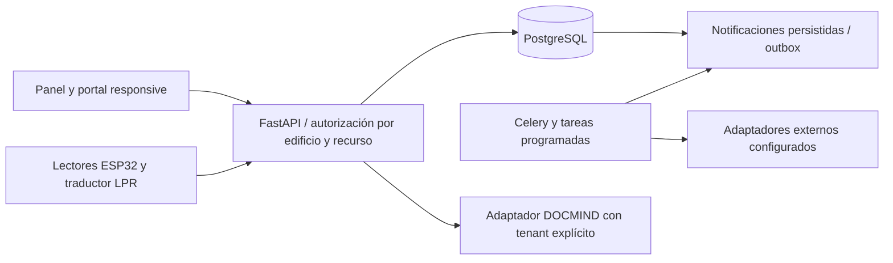

# Arquitectura

Se conserva FastAPI + SQLAlchemy + Alembic, Next.js y Celery/Redis. PostgreSQL es el motor de producción.

## Invariantes

- Un recurso se obtiene siempre por ID y edificio; el edificio de la URL se autoriza con el principal.
- El residente accede a su unidad o a recursos comunitarios publicados. Conserjería no accede a cuentas financieras.
- Las mutaciones y su auditoría se guardan en una transacción. Los envíos externos se desacoplan de esa transacción.
- Los flujos concurrentes bloquean un recurso estable en PostgreSQL; SQLite sólo valida lógica, no demuestra concurrencia productiva.
- Dinero persistido como NUMERIC, cálculos de aplicación de pagos con Decimal, claves de idempotencia validadas.
- Las migraciones nuevas son aditivas. No se ejecutan contra la base operativa.
- Archivos privados se descargan mediante autorización, nunca por rutas públicas predecibles.
- IA sólo consulta fuentes autorizadas. Pagos y accesos requieren acciones humanas explícitas.

## Componentes existentes

`routers/` expone HTTP; `services/` contiene reglas; `models.py` persiste; `tasks.py` agenda trabajo.
El bus `events.py` conserva auditoría. `frontend/lib/api.js` conecta todas las pantallas existentes;
su cliente demo se mantiene explícito y separado de sesiones reales.
El firmware actual falla cerrado sin Internet. El protocolo nuevo de inventario/comandos tiene un simulador
y sólo acepta aperturas para dispositivos marcados de laboratorio. No actúa sobre el firmware físico existente.

## Dominios añadidos

`operations_models.py` conserva incidencias, órdenes, proveedores, planes de mantenimiento, asambleas,
participantes, votos, documentos autorizados, notificaciones, configuración de automatizaciones y dispositivos.
`commercial_models.py` separa clientes/planes/suscripciones/cobros SaaS de las finanzas comunitarias.
Los cobros SaaS son registros internos manuales, no cargos bancarios ni documentos tributarios.

La autorización toma el rol actual y la versión de sesión desde la base. Un cambio de contraseña/rol/estado,
alta MFA o cierre de sesión invalida sesiones anteriores. Producción exige TOTP a administradores y superadministradores;
el secreto TOTP está cifrado con una clave Fernet independiente de JWT_SECRET.

Las reglas programadas generan notificaciones y tareas, nunca pagos o aperturas. El outbox se guarda junto
con el cambio de negocio. Celery lo procesa cada 30 segundos con reintentos; las reglas se revisan cada hora.
La entrega externa es al menos una vez: una caída después del envío y antes del commit puede duplicarla.

Los comandos de laboratorio tienen expiración, clave de idempotencia, nonce y confirmación. Sólo se entregan
una vez; un fallo de red puede dejar un comando expirado sin ejecutar. El usuario debe revisar el historial.
La confirmación reportada por un simulador no demuestra movimiento del portón.

Los límites comerciales serializan altas por edificio. Las instalaciones sin suscripción quedan identificadas
como sin contrato y mantienen compatibilidad. Las suscripciones vencidas impiden nuevas altas de unidades,
residentes y dispositivos; no invalidan acceso a registros existentes ni credenciales físicas.

## Límites de la arquitectura actual

El usuario tiene un edificio y una unidad principales; membresías múltiples y RBAC delegable todavía requieren ampliación.
No se afirma aislamiento por RLS: es aislamiento en aplicación. Los SQL de Supabase históricos no sustituyen Alembic.
La base, los documentos y el outbox deben entrar en el respaldo y restaurarse en un entorno separado.
DOCMIND conserva los archivos fuera de esta base: requiere respaldo propio y coordinación de restauración.
Los listados tienen límites fijos o cursores parciales; no se anuncia paginación uniforme ni búsqueda global.
El uso de FOR UPDATE por edificio favorece integridad sobre paralelismo; debe medirse con carga real por tenant.
No hay libro de doble partida, motor de pasarelas ni membresías multi-organización.
